<p align="center">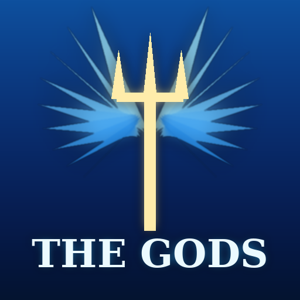</p>

# The Gods

**Diventa una divinità.** Una mod per Minecraft con poteri giganteschi, forme divine animate ed effetti enormi.
Ogni dio ha una forma divina che ti trasforma (ali, corona, aura), 6 poteri e un'**ultimate** devastante.

| | |
|---|---|
| **Minecraft** | 1.21.1 |
| **Loader** | NeoForge 21.1.x |
| **Versione** | 0.3.0, *"Forme degli Abissi"* |
| **Lato** | Client + Server (serve su entrambi) |

<p align="center">
  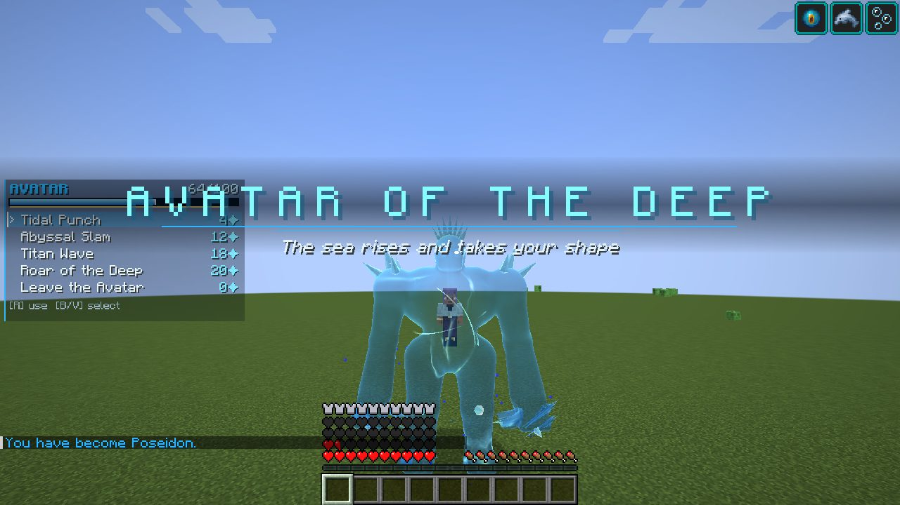
  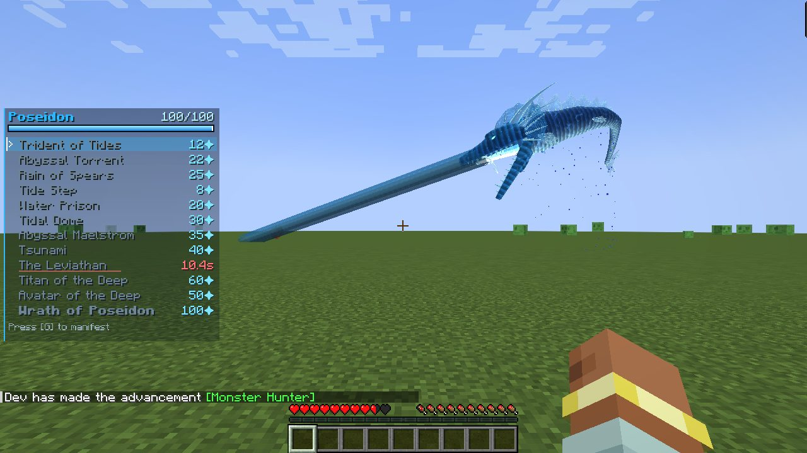
  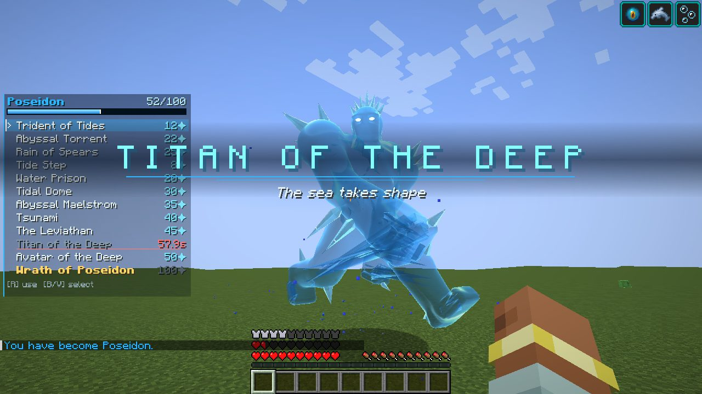
  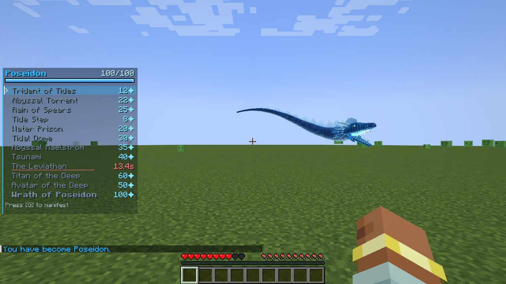
  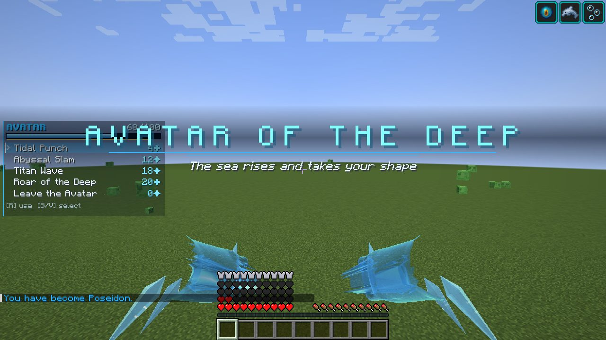
  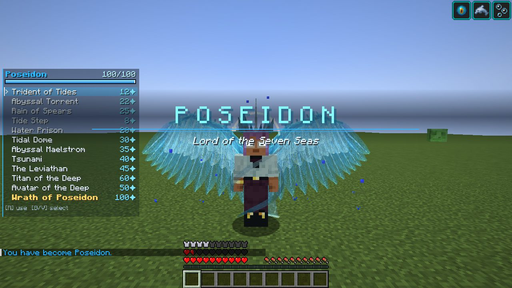
  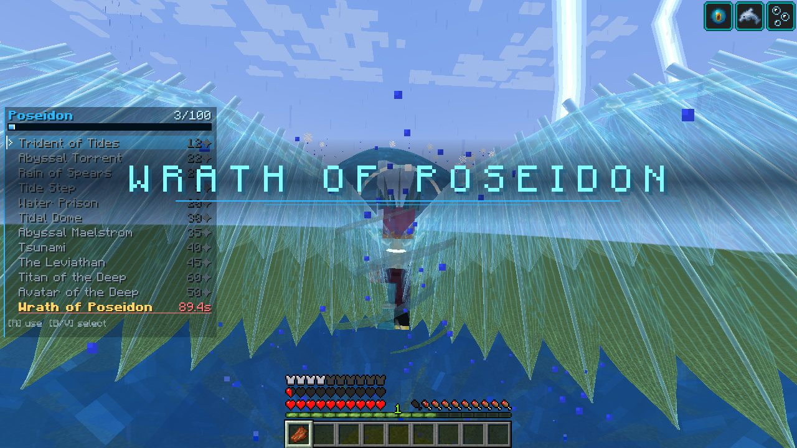
  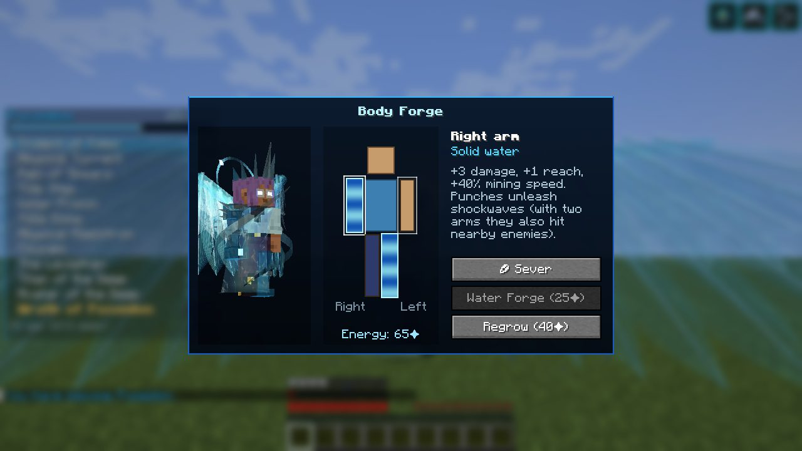
  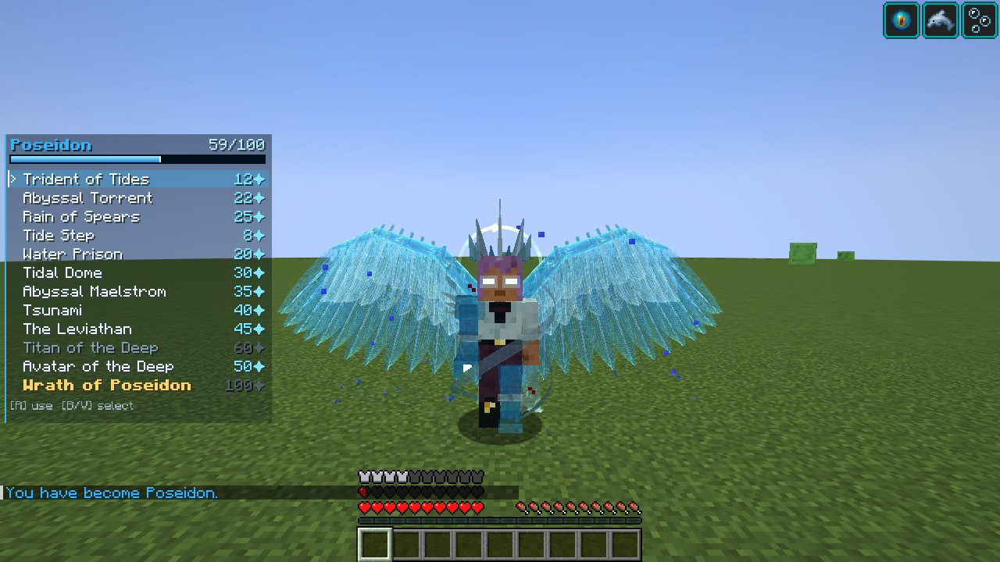
  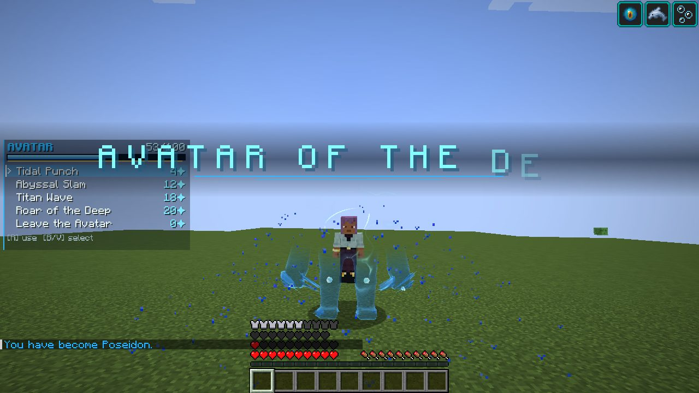
</p>

*(screenshot presi in automatico dal gioco con `./gradlew runShowcase`)*

---

## 🌊 Poseidone, Signore dei Sette Mari

Quando ti manifesti ti spuntano due **ali gigantesche d'acqua viva**: 52 **penne 3D vere** per ala (vessillo curvo con venature e rachide di cristallo). Le penne hanno **fisica a molla**: ritardano sul battito e si piegano col vento quando voli. Sulle spalle porti un **mantello d'acqua con simulazione della stoffa**. Hai anche una **corona di spuntoni d'acqua**, un'**aureola luminosa** e gli **occhi che brillano**. Quando ti manifesti parte un titolo cinematografico e lo schermo trema.

### Forma divina (tasto **G**)
- **Volo** e niente danni da caduta
- +10 cuori, +8 armatura, +4 robustezza, +6 danno, resistenza al contraccolpo
- **Corporatura gigante** (+25%)
- Respirazione acquatica, Grazia del delfino, Forza del condotto
- Immune ai fulmini e all'annegamento, il fuoco si spegne su di te
- L'energia divina si ricarica più in fretta **in acqua o sotto la pioggia**

### Poteri (scegli con **V / B**, usa con **R**): 11 + ultimate
| Potere | Energia | Ricarica | Effetto |
|---|---|---|---|
| **Tridente delle Maree** | 12 | 1,5 s | Un tridente d'acqua lungo 5 blocchi che esplode in un'onda d'urto. Sotto la tempesta richiama il fulmine. |
| **Getto Abissale** | 22 | 8 s | Raggio d'acqua lungo 64 blocchi che segue il tuo sguardo per 2 secondi. |
| **Passo della Marea** | 8 | 2,5 s | Ti dissolvi in acqua e riappari 16 blocchi avanti, travolgendo chi incontri. |
| **Prigione d'Acqua** | 20 | 12 s | Il bersaglio resta intrappolato in una sfera d'acqua sospesa e annega. |
| **Vortice degli Abissi** | 35 | 18 s | Un maelstrom con tromba d'acqua alta 16 blocchi risucchia tutto, poi esplode in un geyser. |
| **Tsunami** | 40 | 15 s | Un muro d'oceano largo 26 e alto 9 blocchi travolge tutto davanti a te. |
| **Pioggia di Lance** | 25 | 10 s | 10 lance di cristallo d'acqua si formano alle tue spalle e partono una dopo l'altra verso i nemici. |
| **Cupola delle Maree** | 30 | 20 s | Sfera d'acqua solida per 10 s: **riflette** frecce e palle di fuoco e respinge i nemici. |
| **Il Leviatano** | 45 | 20 s | Un serpente marino d'acqua a scaglie lungo **~50 blocchi** emerge a spirale dal terreno. Caccia i nemici, li **afferra tra le fauci** e li scaglia, poi si ferma in alto e **spara un torrente d'acqua dalla bocca** prima di rituffarsi. |
| **Titano degli Abissi** | 60 | 60 s | Un **golem d'acqua scolpito alto 7 blocchi** (muscoli, armatura di cristallo) combatte per te per 45 s. **Cavalcabile**: tasto destro per salire, **R** per pugno o schianto a terra. |
| **🌊 Avatar degli Abissi** | 50 | 90 s | **DIVENTI IL TITANO.** Un colosso d'acqua si forma attorno a te dai piedi alla testa e lo guidi da dentro per 60 s. **Sei visibile nel suo petto**, sospeso in un nucleo di luce. Il titano copia ogni tuo movimento. |
| **⚡ L'Ira di Poseidone** | 100 | 90 s | **ULTIMATE.** Tempesta, **otto tsunami** in ogni direzione, fulmini sui nemici per 12 secondi. Le ali diventano ancora più grandi. |

### 🌊 Avatar degli Abissi: le mosse del titano
Quando sei l'Avatar sei alto ~6 blocchi, hai +20 cuori, +16 danno e passi enormi. Ogni pugno genera un'onda d'urto e, se atterri da un salto, esplodi in un'onda d'acqua. In prima persona vedi i tuoi **pugni giganti d'acqua**. La lista dei poteri diventa:

| Mossa | Effetto |
|---|---|
| **Pugno di Marea** | Onda d'urto a cono lunga 12 blocchi |
| **Schianto Abissale** | Balzo enorme ed esplosione all'atterraggio (raggio 10) |
| **Onda del Titano** | Una spazzata del braccio solleva uno tsunami |
| **Ruggito degli Abissi** | Respinge, rallenta e indebolisce tutti entro 18 blocchi |
| **Lascia l'Avatar** | Il titano si scioglie |

### 🦾 Forgia del Corpo (tasto **H**)
Si apre un'interfaccia con la tua **anteprima 3D dal vivo** e lo schema del corpo. Clicca un braccio o una gamba e scegli:
- **✂ Recidi**: ti tagli l'arto (fa un po' male).
- **Forgia d'Acqua** (25✦): al suo posto si forma, a spirale, un **arto di acqua solida**.
- **Rigenera** (40✦): torna di carne.

| Arto | Effetto |
|---|---|
| Braccio d'acqua | +3 danno, +1 portata, scavo +40%, i pugni scatenano onde d'urto. Con due braccia colpisci anche chi è vicino. |
| Gamba d'acqua | +15% velocità, salto e gradini più alti, cadute attutite |
| **Due gambe d'acqua** | **Cammini sull'acqua** (accovacciati per immergerti) |
| Arto reciso | Braccio: −25% danno · Gamba: −35% velocità |

Gli arti d'acqua si vedono in terza persona, in prima persona e nell'anteprima. Restano anche quando lasci la forma divina.

**Passivo, Marea Eterna:** un colpo mortale ti dissolve nel mare invece di ucciderti. Torni a metà vita e respingi i nemici. Funziona una volta al minuto.

---

## 🎮 Come si gioca

**Diventare Poseidone**
- In sopravvivenza: crea la **Conchiglia di Poseidone** e usala col tasto destro.
  ```
  [Nautilo] [Cuore del mare] [Nautilo]
  [Nautilo] [   Tridente   ] [Nautilo]
  [Nautilo] [   Nautilo    ] [Nautilo]
  ```
- Con i comandi: `/gods grant @s poseidon`

**Tasti** (modificabili in *Opzioni → Controlli → The Gods*)
| Tasto | Azione |
|---|---|
| **G** | Assumi/lascia la forma divina |
| **R** | Usa il potere selezionato |
| **V** / **B** | Potere successivo / precedente |
| **H** | Forgia del Corpo |

**Comandi** (servono i permessi da operatore, tranne `list` e `who`)
- `/gods grant <giocatori> <dio>`: rende qualcuno un dio
- `/gods revoke <giocatori>`: toglie la divinità
- `/gods refill [giocatori]`: ricarica energia e poteri
- `/gods list`: elenca gli dèi · `/gods who`: chi è un dio online

**Configurazione:** `config/thegods-common.toml`, oppure *Mods → The Gods → Config* nel gioco. Puoi regolare danno, ricariche, energia, PvP, volo, forma gigante e meteo dell'ultimate.
Nel file `config/thegods-client.toml` puoi spegnere lo **shader dell'acqua** (`fancyWaterShader`) se usi uno shaderpack (Iris/Oculus) e i modelli d'acqua non si vedono bene. Puoi anche spegnere il **mantello** (`waterCape`).

---

## 🎨 Come sono fatti i modelli

Abbiamo studiato la mod a cui ci ispiriamo, *Ronova: Ruler of Death*. **Non usa GeckoLib** né modelli a cubi di Blockbench. Usa invece:
- **mesh 3D vere**, cioè migliaia di poligoni esportati da un programma 3D in file JSON (ali, vestito, velo, corvi con più livelli di dettaglio);
- **shader GLSL personalizzati** per gli effetti (fusione additiva);
- **texture animate a fotogrammi**;
- **simulazione della stoffa** su vestito, velo e ali.

The Gods segue lo stesso approccio, senza dipendenze esterne:
- **Mesh scolpite** con un generatore Python (`tools/meshgen`), tramite superfici implicite (SDF) e *marching cubes*. Ne escono un Titano con muscoli, mani e armatura di cristallo (~16.000 triangoli) e una testa di Leviatano con cranio, mandibola, denti, corna e creste (~11.000 triangoli).
- **Scheletro e skinning**: il Titano ha 11 ossa e i vertici si deformano in modo morbido sulle articolazioni.
- **Shader dell'acqua divina** (`assets/thegods/shaders/core/water_fx`): caustiche animate, riflessi di Fresnel, scaglie, cristallo e membrane, tutto procedurale.
- **Fisica**: molle sulle penne, stoffa Verlet sul mantello, corde sui barbigli del Leviatano.

---

## 📦 Installazione

Ogni versione è nella cartella [`releases/`](releases/) con due archivi:

1. **`TheGods-<versione>-CurseForge.zip`**: per giocare subito.
   App CurseForge → *Minecraft* → **Crea profilo personalizzato** → link **"Importa"** in alto → scegli lo zip.
   L'app scarica da sola Minecraft 1.21.1 e NeoForge, e la mod è già dentro.
2. **`TheGods-<versione>-Segnaposto.zip`**: il codice completo con il file [`SEGNAPOSTO.md`](SEGNAPOSTO.md). Serve a riprendere lo sviluppo in un'altra chat.

In alternativa metti `thegods-<versione>.jar` nella cartella `mods` di un'installazione NeoForge 1.21.1.

---

## 🛠️ Sviluppo

```bash
./gradlew build                 # compila -> build/libs/thegods-<versione>.jar
./gradlew runClient             # avvia il gioco con la mod
./gradlew runGameTestServer     # test automatici di tutti i poteri
./gradlew runShowcase           # entra in un mondo, usa ogni potere e salva screenshot in run/showcase/screenshots
./gradlew runShowcase -Pscene=avatar   # scene brevi: avatar, titan, leviathan, wings
.meshenv/bin/python tools/meshgen/build_meshes.py   # rigenera le mesh 3D (vedi SEGNAPOSTO.md)
./tools/package_release.sh      # crea i 2 zip della versione in releases/
python3 tools/generate_assets.py  # rigenera texture, logo e struttura dei test
```

L'architettura e come aggiungere nuovi dèi sono spiegati in [`SEGNAPOSTO.md`](SEGNAPOSTO.md).

---

*The Gods è un progetto originale. Le divinità si ispirano alle mitologie del mondo.*
